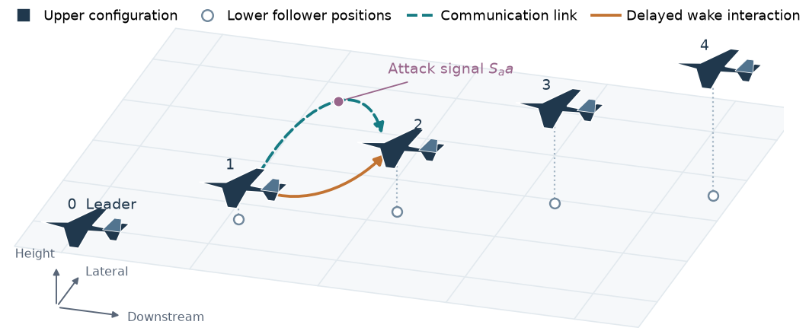
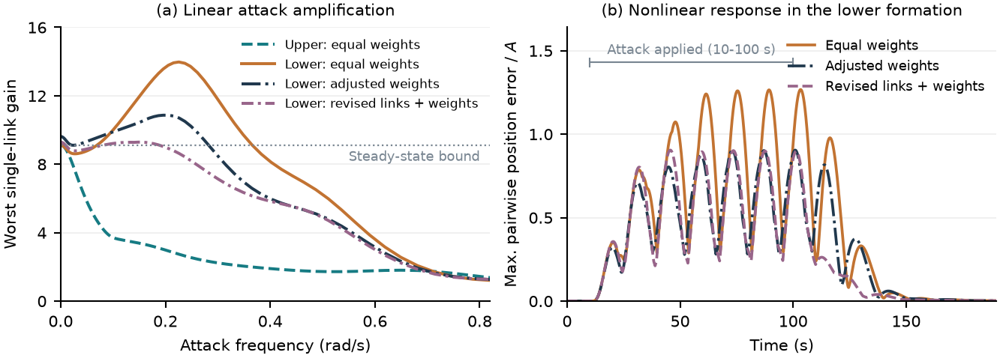
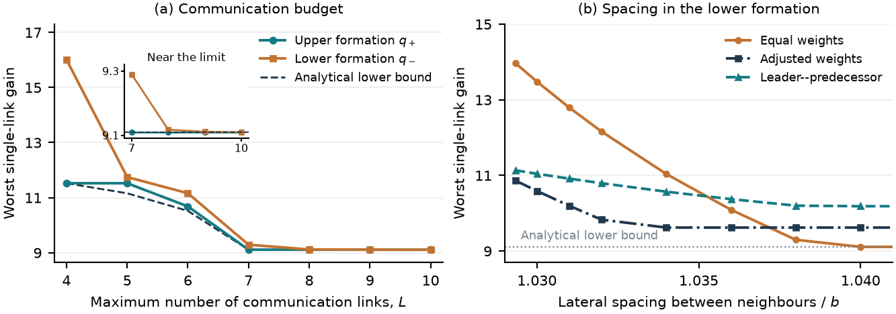

# Communication Design for Multi-Agent Aircraft Formations Under Attack

**Ali Eslami and Jiangbo Yu — McGill University**

Research manuscript prepared for ECC 2027. This repository accompanies the eight-page conference draft; it is not a statement of acceptance or publication.

Aircraft exchange navigation data and interact physically through their wakes. We study which communication links and weights reduce the worst effect of an attack on one received link. The analysis establishes a steady-state lower bound and gives designs and minimum link requirements for attaining it. Delayed aircraft models and nonlinear case studies examine how geometry affects dynamic performance.



## Paper and project page

- [Manuscript](paper.pdf)
- [Project page](https://alieneslami.github.io/formation-attack-design/)
- [LaTeX source and manuscript figures](manuscript_source.zip)
- [Model definitions, units, and controller details](MODEL_DETAILS.md)
- [Numerical study settings and interpretation](STUDY_DETAILS.md)

## Reproduce the exported-model checks and figures

Use Python 3.12 or later. Download the repository, then run from its root:

```sh
python -m pip install -r requirements.txt
python prepare_data.py
python verify_exported_models.py
python verify_budget_results.py
python reproduce_figures.py
```

The first check reconstructs the full delayed transfer matrix for **117 models** and compares the single-link gains at **702 stored frequency/model combinations**. The budget script checks the algebraic complete-graph and sparse examples, outward-directed trees, and sampled general-graph inequalities. These checks supplement the analytical proofs; they do not replace them.

`reproduce_figures.py` redraws Figures 4 and 5 from the released arrays and trajectories and writes PDF/PNG files to `reproduced_figures/`. It does not rerun the topology optimizations or nonlinear aerodynamic simulations.

## Contents

| File or extracted directory | Contents |
| --- | --- |
| `linear_models.zip` → `models/` | 117 assembled delayed linear systems, communication weights, and reference frequency gains |
| `linear_models.zip` → `aircraft_models/` | Per-aircraft matrices, wake coupling matrices, delays, and state/input ordering for 34 operating points |
| `numerical_records.zip` → `evidence/` | Weight searches, budget and geometry studies, frequency-cover records, and numerical summaries |
| `nonlinear_trajectories_*.zip` → `evidence/` | Recorded nonlinear trajectories, including integration-step checks and earlier model-domain exits |
| `figure4_revised_curve.npz` | Exported frequency curve for the revised seven-link design in Figure 4 |
| `SHA256SUMS.json` | Integrity hashes for the released files |

## Reading the results



Figure 4 compares equal weights with adjusted weights and revised links plus weights. All three use seven links. In the lower formation, the numerical designs reduce peak dynamic amplification and the peak position error under the same selected oscillating attack. This is a tradeoff: their steady-state gains can be higher.



Figure 5 shows the best designs found within each communication budget and how fixed seven-link designs compare as lateral spacing changes. Lower gains mean less attack amplification. The analytical lower bound and the numerical designs are distinct: the continuous-weight searches do not establish global dynamic optimality.

## Reproduction scope and provenance

The release supports independent reconstruction of the exported delayed linear systems, verification at the stored frequencies, algebraic budget checks, and regeneration of Figures 4–5. It also provides the recorded nonlinear results and numerical frequency-cover certificates. A successful stored-frequency check alone is not a proof of a global frequency maximum; the manuscript Appendix and accompanying cover records describe the separate full-frequency bounds. Those reported numerical bounds use ordinary floating-point evaluation with padding, not validated interval arithmetic.

Full nonlinear regeneration requires the original NASA GUAM aerodynamic implementation and the project's model-generation pipeline. These third-party aerodynamic sources are not redistributed in this compact release. The NASA GUAM source revision used was `794facc40155c0343a45e688945745b38691d988`; the manuscript and `MODEL_DETAILS.md` identify the model and wake references. The complete exported matrices and numerical histories needed for the checks above are supplied here.

The attack is on one active communication link, with one energy budget shared by its seven signal components. Local controllers are fixed; incoming communication weights are nonnegative and sum to one. The physical and communication graphs admit a common forward order. See the paper for the steady-state response assumptions and the scope of each result.

## Citation and contact

Please cite the manuscript title and authors when referring to this research. No conference acceptance, DOI, or final publication identifier has been assigned in this release.

Ali Eslami: ali.eslami@mcgill.ca  
Jiangbo Yu: jiangbo.yu@mcgill.ca
